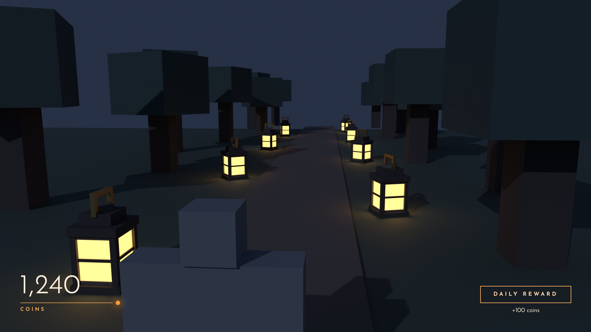

# Roblox Dev with Claude: Starter Kit

    


<sub>From the worked examples: a lantern model and a HUD taken through every stage with Claude.</sub>

### [Read the full guide →](https://claude.ai/artifact/3bpvaYyZkPqS3uQGohvuqP)
Setup, how everything works, worked examples, playable UI previews from real games (Verdict and Bleach), the 3D pipeline, and how to prompt, all on one page.

Everything you need to make Roblox games with [Claude Code](https://claude.com/claude-code) as your dev partner. One install gets you:

| | What it is | Why it matters |
|---|---|---|
| **The Brain** | An Obsidian vault Claude reads at the start of every chat and writes back to with `/save` | Claude forgets everything between chats. The brain is its memory: where code lives, what broke last time, what's next |
| **Studio MCP** | Roblox's built-in MCP: Claude reads/edits the place, runs real playtests, presses keys, takes screenshots. Plus a small bridge for local file uploads and Studio → Blender export | Claude can test its own work instead of you copy-pasting errors |
| **Base framework** | A Roblox game skeleton with data saving, networking, UI, cleanup and an admin console already wired | You start on gameplay, not plumbing, and Claude always knows where code goes |
| **3D pipeline** | Blender MCP (Claude drives Blender), Studio → Blender export, Substance automation, upload | Models from brief to in-game, step by step, with checkpoints |
| **Workflows** | Step-by-step contracts for scripting, bug fixes, UI screens, 3D assets | Same quality every time; each one has a checklist Claude runs before showing you anything |
| **Worked examples** | A 3D lantern and a HUD taken through every stage, mistakes included ([examples/](examples/)) | Shows the quality bar instead of describing it |

## Setup

**Easiest:** clone the repo, open Claude Code inside it and say *"set this up for me"*. The repo's `CLAUDE.md` tells Claude what everything is, how to install it and how to fix common problems.

**You need:**
- [Obsidian](https://obsidian.md/download), [Claude Code](https://docs.claude.com/en/docs/claude-code/overview), git and [Node.js 22+](https://nodejs.org).
- For Roblox: [Roblox Studio](https://create.roblox.com), [Rokit](https://github.com/rojo-rbx/rokit), [Blender](https://www.blender.org/download/) and [uv](https://docs.astral.sh/uv/) (`brew install uv`).
- Mac is the main target. On Windows, run the script in Git Bash and the bridge's `install.ps1`.

1. Clone this repo somewhere outside `~/Documents`:
   ```bash
   git clone https://github.com/Taneelkins/claude-brain-starter.git ~/Developer/claude-brain-starter
   ```
2. Run the installer. It asks your name, and whether to set up the Roblox tools (say yes):
   ```bash
   ~/Developer/claude-brain-starter/install.sh
   ```
   - **Brain:** creates the vault at `~/Documents/Claude Brain` (`VAULT=/path ./install.sh` to change it).
   - **Obsidian:** downloads the 4 plugins it uses.
   - **Claude:** installs `/brain`, `/save`, `/brain-audit`, `/new-project` and `/new-game`, and links `~/.claude/CLAUDE.md` to the vault's rules. An existing `CLAUDE.md` is never overwritten.
   - **Roblox tools:**
     - Clones and builds the [Studio bridge](https://github.com/Taneelkins/claude-studio-bridge) into `~/claude-studio-bridge`, installs its Studio plugin and its always-on daemon, and registers it with Claude. It only handles uploads and Blender export.
     - On Mac, registers Roblox's built-in Studio MCP (the main Studio tool).
     - Registers the Blender MCP server and installs its Blender add-on.
3. Open Obsidian → **Open folder as vault** → `~/Documents/Claude Brain` → **Trust author and enable plugins**.
4. In Studio: **Assistant → ⋯ → Settings → MCP Servers** → enable. On Windows also run `claude mcp add Roblox_Studio -s user -- "<Studio install folder>\StudioMCP.exe"`.
5. Restart Claude Code and Roblox Studio so the new tools load. If Studio asks to let a plugin or the MCP edit scripts, click **Allow**.
6. Install the Rojo Studio plugin once: `rojo plugin install` (after Rokit has installed Rojo; `/new-game` does that).
6. Make your first game. In Claude Code:
   ```
   /new-game my-first-game
   ```
   Claude copies the framework to `~/Developer/my-first-game`, installs its packages, adds the game to your brain, and asks three questions about its look.

## Daily loop
1. **Open a chat in your game's folder.** Claude reads the brain and says in one line what it loaded. `/brain` = "what's next" across all your games.
2. **Ask for one thing per chat**: a system, a bug, a screen, a model. Claude follows the matching workflow and stops at checkpoints to show you.
3. **`/save`** after each chunk. New facts, traps and next steps go into the brain. Saving is manual on purpose, so you see what goes in.
4. **`/brain-audit <game>`** every few weeks catches notes that went stale.

## Asking well
- **Systems:** "Add a shop: 3 items, prices, purchases save." Claude finds where it belongs in the framework, shows a plan if it's big, builds it, playtests it through Studio's MCP.
- **Bugs:** paste the error. Claude reproduces it, fixes the smallest thing, and re-tests.
- **UI:** "Make a shop screen." Claude mocks 2–3 directions over a real game frame; you pick one; it measures the mock and rebuilds it in Fusion 1:1. The taste rules are in `vault/Roblox/UI Craft.md`; see `examples/ui-hud/`.
- **3D:** fill in the asset brief (`Art Direction/Asset Brief Template` in the vault) and attach 2–3 reference images. Blocky styles Claude builds in Blender itself; realistic characters/creatures you generate with an AI 3D tool from Claude's brief, and Claude does the clean-up, textures, rig and import.

## What's where
| Path | |
|---|---|
| `vault/` | the brain's starting notes (copied to your vault once; yours after that) |
| `vault/Roblox/` | framework rules, module kit, Studio MCP + bridge, 3D pipeline, gotchas |
| `vault/Workflows/` | Feature, Bug Fix, Roblox Scripting, UI Screen, 3D Asset, Studio Safety |
| `vault/Art Direction/` | Style Bible (one section per game) + asset brief template |
| `roblox-template/` | the base framework ([its README](roblox-template/README.md)) |
| `tools/3d/` | Blender build/export scripts + Substance job ([README](tools/3d/README.md)) |
| `tools/ui/` | `measure.mjs`: turns a 1920×1080 HTML mock into exact Roblox offsets, fonts and colours |
| `examples/` | the worked examples ([walkthrough](examples/index.html), [README](examples/README.md)) |
| `claude/commands/` | the slash commands |

## Updating
```bash
cd ~/Developer/claude-brain-starter && git pull && ./install.sh --update
```
Refreshes the commands and plugins; never touches your notes. If the starter's notes or workflows improved, ask Claude: *"compare my vault's Playbook, Roblox and Workflows notes with ~/Developer/claude-brain-starter/vault and merge anything new."*

## Make it yours
- **`Playbook/Claude Rules.md`** is your global `CLAUDE.md`. Rule 1 makes Claude push back instead of agreeing with everything. Tune it.
- **Back up your vault**: it's your notes, not this repo. Make it a private git repo or use Obsidian Sync.
- New kinds of work you repeat (VFX, sound, monetization) → new workflow from `_templates/Workflow.md`.
